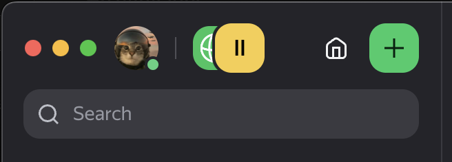

# ym-patches

Локальные патчи для десктопных клиентов Яндекс Мессенджера на macOS.

## telemost — Yandex Telemost (Qt 6.8 + QtWebEngine)



Что меняет:

| | До | После |
|---|---|---|
| Превью ссылок | Клиент запрашивает превью для каждой ссылки и рисует карточку (когда сервер разрешает) | Не запрашивает и не рисует нигде: ни в чате, ни во вкладке «Ссылки» |
| Рамка окна | Чёрная рамка 12px со скруглением вокруг всего интерфейса | Интерфейс до краёв окна |
| Заголовок окна | Системный titlebar 28pt над контентом | Прозрачный titlebar, контент под ним, кнопки окна в шапке сайдбара на одной линии с аватаркой |
| Перетаскивание окна | За titlebar | За верхнюю полосу 56pt, двойной клик — zoom |
| Шапка чата | Прижата к верху, клик в любом месте открывает меню чата | Выровнена по строке с аватаркой. Меню открывается только по аватарке, названию или статусу, пустое место — зона перетаскивания окна |
| Уведомления | Обо всех сообщениях | Только: чаты из папки «Important» (или «Важное»), сообщения с упоминанием тебя, входящие звонки и серверные уведомления, адресованные лично тебе. Остальное не показывается, счётчик непрочитанных не меняется. Если такой папки нет, приходят все уведомления, как в стоке |
| Закрытое окно по Cmd+Tab | Не появляется (появляется только по клику в Dock) | Появляется: при активации приложения без открытых окон скрытое главное окно показывается |

### Как устроено

Телемост — нативное Qt-приложение. Чат — веб-бандл Яндекс Мессенджера (`ychat://files/index.html`), зашитый в Qt-ресурсы бинарника и открытый в `QWebEnginePage`. Минифицированный JS меняется с каждой сборкой, поэтому бандл не правится. Вместо этого в процесс подгружается свой dylib:

1. **`insert_dylib.py`** добавляет `LC_LOAD_DYLIB @executable_path/../Frameworks/TelemostTweaks.dylib` в оба слайса (arm64, x86_64) главного бинарника.
2. **`tweaks.mm`** → `TelemostTweaks.dylib`:
   - через `__DATA,__interpose` перехватывает конструкторы `QWebEnginePage` и кладёт в `page->scripts()` скрипт `tweaks.js` (`DocumentCreation`, main world);
   - для главного окна (`QNSWindow` с заголовком «Telemost») включает `NSWindowStyleMaskFullSizeContentView` и прозрачный titlebar, переносит кнопки окна и ставит монитор событий для перетаскивания;
   - обнуляет `safeAreaInsets` у `QNSView` этого окна: Qt 6.8 вычитает safe area из layout виджетов, без этого веб-вью остаётся на 28pt ниже.
3. **`tweaks.js`**:
   - превью ссылок в бандле гейтятся селектором `e => a(e, "url_previews_enabled")`, который читает `state.config.degradation.url_previews_enabled` — серверный kill-switch Яндекса (поэтому превью то есть, то нет). Скрипт ловит инициализацию webpack-рантайма (`webpackChunk_yandex_int_messenger.push`), оборачивает `__webpack_require__.d` и подменяет экспорт-функцию, тело которой содержит `"url_previews_enabled"`, на `() => false`. Поиск идёт по строке протокола, а не по минифицированным именам. Этот же селектор стоит и перед запросом (`preview/update` thunk), и перед рендером, так что сеть не трогается вообще;
   - уведомления: все десктопные уведомления собирает одна функция `(state, event) => ({type: NOTIFICATION, data: {chat_id, incomingCallId, forceShow, …}})`, результат уходит в шину `ipc` и дальше в нативную часть (`bridge.showNotification`). Скрипт находит её по полям `incomingCallId:` и `forceShow:` и оборачивает: для отфильтрованных событий возвращает действие неизвестного типа, а у ipc-обработчика нет ветки `default`, так что ничего не показывается. Состав папки берётся из `state.buckets.folders` (`included_chat_ids`) и из состава, который вычислил сам клиент (`state.metastore.folders.byOrg`, учитывает и типы чатов). Для тредов проверяется родительский чат. Упоминание — `message.mentions` содержит твой `authId`. Если папки нет (или папки ещё не загрузились) или фильтр бросит исключение, уведомление показывается. Статистика и последние 30 решений (без текста сообщений): `window.__telemostTweaks.notifications`;
   - CSS: убирает `padding` у `.yamb-root__content_window-frame` и скругление у `.yamb-root__layout`, сдвигает `.yamb-sidebar-navigation-header__identity` вправо под кнопки окна, опускает `.yamb-chat-header` на линию аватарки и оставляет кликабельными в ней только аватарку, текст и кнопки, на всякий случай прячет `.yamb-url-preview`.
   - при активации приложения (`NSApplicationDidBecomeActiveNotification`, это и Cmd+Tab) dylib проверяет, есть ли видимое окно с заголовком. Если нет, показывает скрытое главное окно через Qt (`showNormal`/`raise`/`activateWindow`), а не через AppKit, чтобы Qt знал, что окно открыто. Главное окно — `Orbita::Frame`: у виджета пустой `windowTitle`, «Yandex Telemost» стоит только на нативном окне, поэтому заголовок проверяется у обоих, а запасной вариант — самое большое обычное top-level окно. Клик в Dock Телемост обрабатывает сам (reopen), ему даётся 300 мс до проверки. Если окно не нашлось, в лог пишется список всех виджетов и окон.
4. **Подпись.** После правки бинарника подпись Яндекса недействительна, а arm64-бинарник без валидной подписи ядро убивает. `patch.sh` переподписывает бандл локальным самоподписанным сертификатом «TelemostTweaks Local Signing» (создаёт `make-identity.sh`, ключ лежит в login keychain, доступен только `codesign`). С ним требование подписи — `identifier "ru.yandex.desktop.telemost" and certificate leaf = H"…"`, оно не меняется между переподписями. С ad-hoc подписью требование — cdhash бинарника, он меняется при каждом перепатче, и разрешения macOS (запись экрана, камера, микрофон) молча перестают действовать: переключатель в настройках включён, а приложение снова просит доступ. Если сертификата нет, `patch.sh` подписывает ad-hoc и пишет об этом в лог. Подпись **без hardened runtime**: с ним library validation не дала бы загрузить Qt-фреймворки Яндекса (Team ID `477EAT77S3`) рядом с бинарником, подписанным кем-то ещё. Entitlements сохраняются. Подписанный Mach-O нельзя перезаписывать на месте: ядро кэширует подпись по vnode, и следующий запуск падает в dyld с `Code Signature Invalid`. Поэтому dylib и бинарник подменяются копией в новый файл и `mv`.

### Установка

```bash
cd telemost && ./install.sh
```

`install.sh` собирает dylib (нужны Xcode CLT и заголовки Qt из Homebrew: `brew install qt`), создаёт сертификат подписи, если его нет, копирует всё в `~/Library/Application Support/TelemostTweaks`, патчит Телемост и регистрирует LaunchAgent `local.telemost-tweaks`.

### Обновления Телемоста

LaunchAgent следит (`WatchPaths`) за `Contents/MacOS/Yandex.Telemost` и `Contents/Info.plist`. Когда обновление подменяет бинарник, агент запускает `patch.sh`. Тот:
- ждёт, пока апдейтер допишет бандл;
- бэкапит оригинальный бинарник и `_CodeSignature` в `~/Library/Application Support/TelemostTweaks/backup/<CFBundleVersion>/`;
- вставляет dylib и переподписывает;
- если Телемост в этот момент запущен, показывает уведомление о необходимости перезапуска.

Проверено симуляцией: `patch.sh --restore` вернул оригинальный бинарник, через ~7 секунд агент перепатчил его сам.

Если новая версия сломает якоря:
- превью: в консоли страницы `window.__telemostTweaks.requireHooked` будет `false`;
- окно: в логе не будет строк `chrome applied` / `safeAreaInsets hooked`.

### Отладка

- Лог: `~/Library/Logs/TelemostTweaks.log`.
- Править CSS/JS без пересборки: положить свой вариант в `~/Library/Application Support/TelemostTweaks/tweaks.override.js`, он имеет приоритет над вшитым.
- Уведомления: в лог пишутся статус авторизации уведомлений macOS при старте и ответ macOS на каждое уведомление (`notification N -> accepted by macOS` или текст ошибки). Если там `accepted`, а баннера нет, причина в Focus/«Не беспокоить» или в стиле уведомлений Телемоста в системных настройках.
- Бисекция: переменные окружения `TT_NO_WEB=1` (без инъекции JS/CSS) и `TT_NO_WINDOW=1` (без правок окна) при запуске бинарника из терминала.
- DevTools: запустить `QTWEBENGINE_REMOTE_DEBUGGING=127.0.0.1:9333 /Applications/Yandex.Telemost.app/Contents/MacOS/Yandex.Telemost` и открыть `http://127.0.0.1:9333`.

### Откат

```bash
cd telemost && ./install.sh --uninstall
```

Удаляет агент и возвращает оригинальный бинарник с подписью Яндекса (из бэкапа текущей версии).

### Разрешения macOS после первой установки

Подпись меняется с яндексовской на локальную, поэтому разрешения, выданные оригиналу, нужно выдать заново, один раз:

```bash
tccutil reset ScreenCapture ru.yandex.desktop.telemost
```

Затем начать демонстрацию экрана, включить Телемост в «Конфиденциальность → Запись экрана» и перезапустить. Камеру и микрофон Телемост спросит сам. Keychain может спросить доступ к сохранённым ключам — ответить «Всегда разрешать». После этого перепатчи и обновления разрешения не сбрасывают.

### Известное

- На широком окне Телемост показывает слева рейку папок, и кнопки окна ложатся на неё. Не исправлено.
